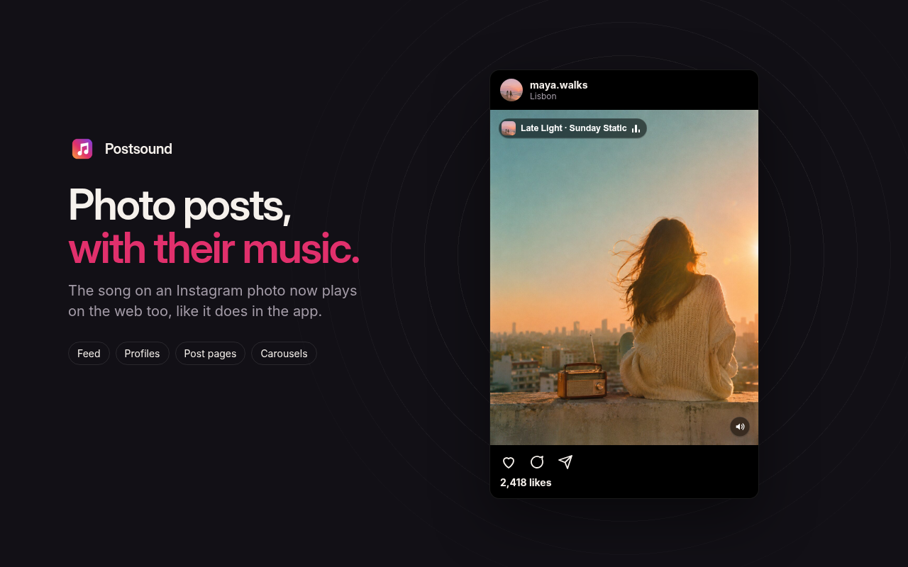
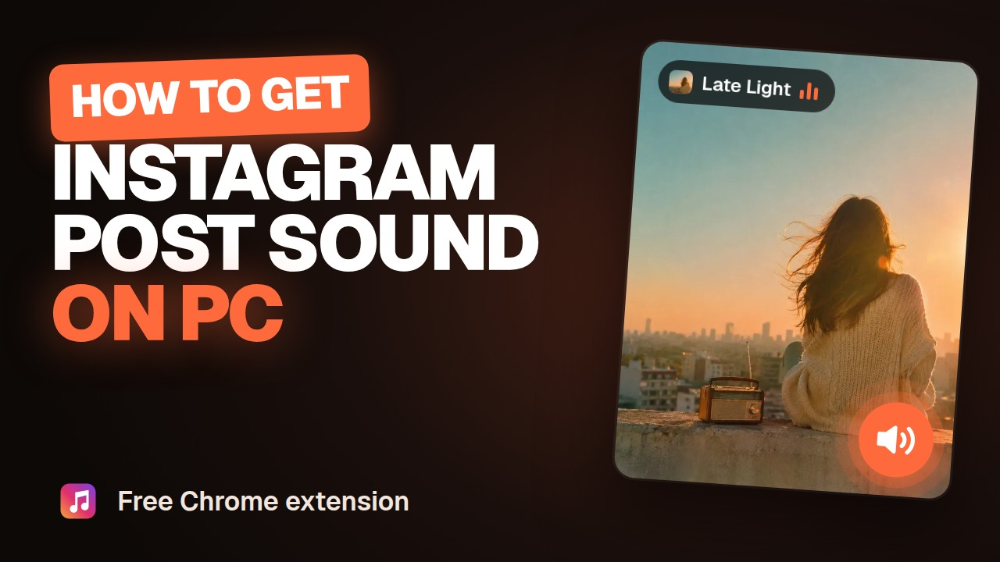
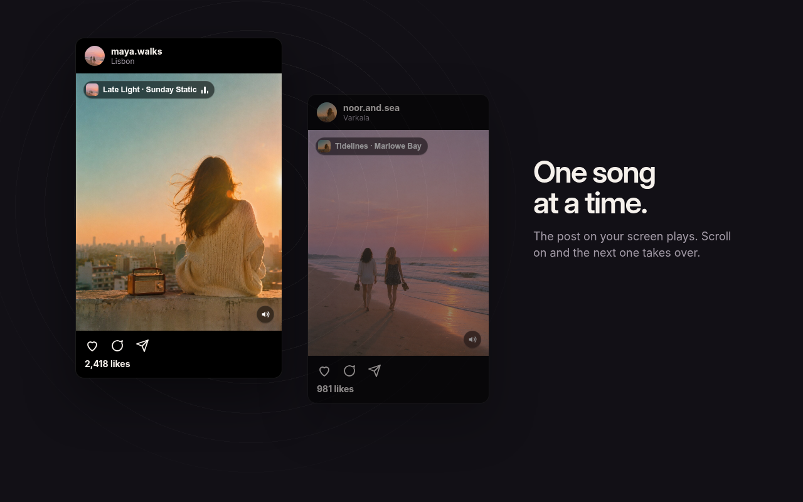
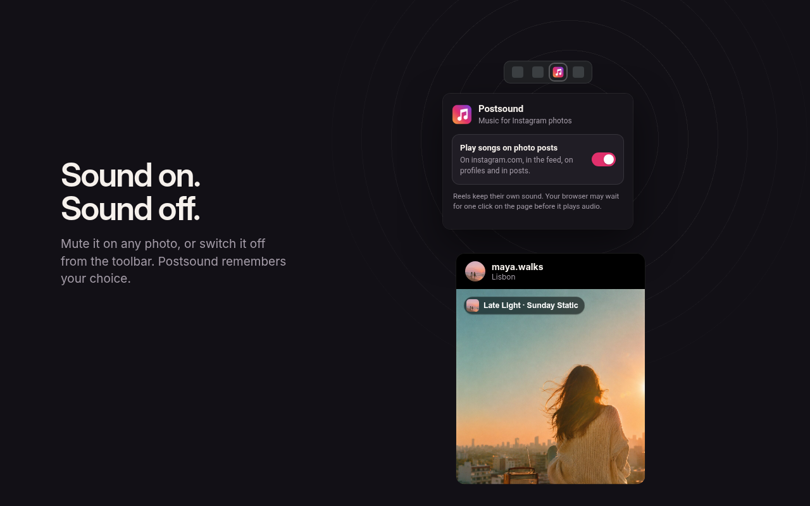
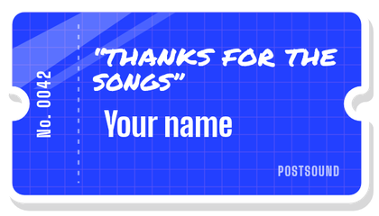

# Postsound

A browser extension for Chrome and Firefox. It plays the music on Instagram photo and carousel posts on instagram.com, as the mobile app does.

**[Try the demo at postsound.deepanalve.dev](https://postsound.deepanalve.dev)** · **[Buy me a sticker](https://guestbook.deepanalve.dev/sign?product=postsound)**

Firefox Add-ons has version 1.1.0 in review. The Chrome Web Store listing comes next.

## Watch

**[Launch trailer on YouTube](https://youtu.be/h4bhhLRea5k)** · **[Vertical Short](https://youtube.com/shorts/DAcvq7zz2go)** · **[All videos on @deepanalve](https://www.youtube.com/@deepanalve)**

| One song at a time | The toolbar popup |
|---|---|
|  |  |

## Why the web has no music

- The web feed data has no song fields for photo posts.
- The media info API, `/api/v1/media/<pk>/info/`, returns `music_metadata` for the same post.
- That data holds the title, the artist, the cover, an audio URL, the clip start and the clip length.

## What it does

- It finds posts in the feed, on profiles, on post pages and in the post popup.
- It fetches the media info for each post that comes on screen. It sends one request at a time.
- It shows a song pill at the top left and a sound button at the bottom right of the photo.
- It plays the clip of the post that fills most of the screen. The clip loops.
- It stops the song when you scroll away, close the popup or hide the tab.
- It gives way to a video that plays with sound on screen.
- The toolbar popup shows the song on screen, plays or pauses it, and sets the volume.
- The popup and the sound button share one on/off setting. The extension remembers it.
- When the browser blocks sound, the pill says "Click to play". One click anywhere on the page starts it.
- The About page has the support link, a problem report that opens a prefilled email, and the contact address.

Reels are skipped. They have their own audio.

## Install for development

Chrome:

1. Open `chrome://extensions` and turn on **Developer mode**.
2. Click **Load unpacked** and select this folder.
3. After a code change, click the reload icon on the Postsound card.

Firefox:

1. Run `npm run build`.
2. Open `about:debugging#/runtime/this-firefox`.
3. Click **Load Temporary Add-on** and select `dist/postsound-firefox-<version>.xpi`.

Firefox removes a temporary add-on when it closes. Release Firefox keeps only add-ons that Mozilla signed.

## Commands

| Command | What it does |
|---|---|
| `npm test` | Unit tests for `music.js` |
| `npm run build` | Writes `dist/postsound-chrome-<v>.zip` and `dist/postsound-firefox-<v>.xpi` |
| `npm run test:e2e` | Chromium with the real extension against a mocked instagram.com: overlay, popup, feed, About page, phone widths. Set `PLAYWRIGHT_MODULE` and optionally `CHROMIUM_PATH` |
| `npm run test:firefox` | Headless Firefox, logged out: install, one request per post, no retries |
| `node scripts/firefox-smoke.mjs --login DIR` | Firefox with a kept profile against real Instagram. Log in once in the window. Add `--headless` after that, and `--block-autoplay` to test click-to-play |
| `node scripts/store-assets.mjs` | Renders the store images into `store/` |

The extension and the build need no npm packages: Node 22 or later, `zip`, Firefox and Chrome are enough. Only `test:e2e` needs Playwright and its Chromium.

## Publish

`store/LISTING.md` holds the name, the store copy, the privacy answers and the reviewer notes.
`PRIVACY.md` is the privacy policy text.

## Files

- `manifest.json`: Manifest V3 for Chrome. `scripts/build.mjs` adds the Firefox keys.
- `music.js`: pure data helpers. The unit tests cover them.
- `content.js`: finds posts, fetches the song data and plays it.
- `content.css`: the pill and the sound button. Every class starts with `ps-`.
- `popup.html`, `popup.css`, `popup.js`: the toolbar popup.
- `about.html`, `about.css`, `about.js`: support, problem report and contact. It is also the options page.
- `config.js`: the support, issue and contact links. An empty URL hides its button.
- `tokens.css`, `design.md`: the design system (hallmark, modern-minimal, Coral). Read `design.md` before UI changes.
- `fonts/`: Geist Variable under the OFL. `icons/LICENSE-lucide.txt` covers the inlined Lucide icons.
- `icons/`: rendered from `brand/icon.svg`. `brand/alt-icon-record*.svg` is an unused alternative.
- `store/`: store images and listing copy. `store/src/` holds their sources.

## Limits

- It uses a private Instagram API. Instagram can change it without notice.
- Instagram can rate limit the requests. On HTTP 429 the script waits 30 seconds.
- A failed request is not sent again for 15 seconds. A redirect or a bad answer is not sent again in that tab.

## Support

Postsound stays free. If it made your feed better, buy me a sticker. You get a one-of-one sticker made from your name, stuck on a live wall with everyone who keeps Postsound going.

**[Buy me a sticker](https://guestbook.deepanalve.dev/sign?product=postsound)**

## More tools by Deepan

| Tool | What it does |
|---|---|
| [Postsound](https://postsound.deepanalve.dev) | Plays the music on Instagram photo posts in your desktop browser. |
| [GhostShot](https://ghostshot.deepanalve.dev) | Drag-to-capture screenshots for GNOME Shell. |
| [Handwriting](https://write.deepanalve.dev) | Turns typed text into realistic handwritten pages. |
